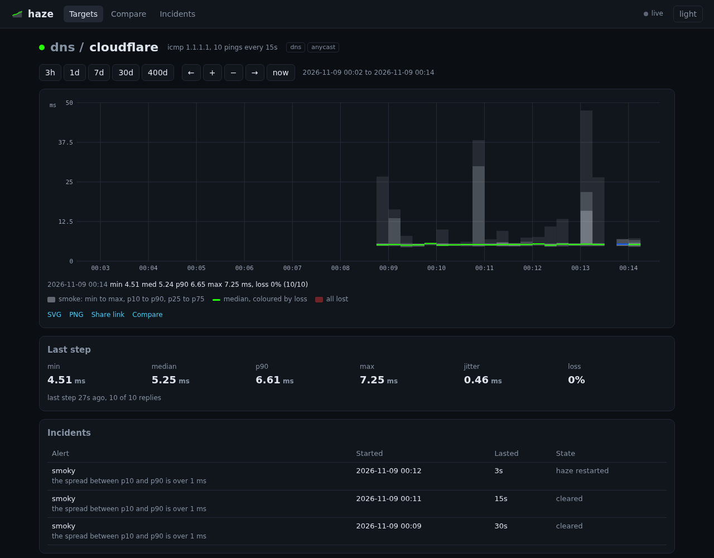

# haze

Latency and loss monitoring with smoke graphs, in the spirit of SmokePing. Every step sends a
number of probes spread across the interval, keeps every round trip time, and stores the whole
distribution so a graph of last year shows the same smoke as a graph of the last hour.



## Status

Early. It runs ICMP, UDP echo, TCP connect, HTTP/HTTPS and DNS probes, stores every
step with hourly and daily rollups, evaluates alert rules, sends webhook and ntfy notifications
and serves a web dashboard from the same binary. There is no agent mode yet; `docs/design.md` has
the plan.

## Use

```
haze ping 1.1.1.1 -c 20
haze ping https://example.com/ --probe http -c 5
haze ping example.com --probe tcp -p 443
haze ping 8.8.8.8 --probe dns --name example.com --record AAAA
haze check haze.toml
haze run haze.toml
haze show data --last 1h
```

`ping` prints one smoke line: the shaded cells show where the replies fell on a 0 to scale ms
axis, `|` is the median.

```
1.1.1.1 10 pings over 5.0s, scale 0-20.0 ms
[         ░|░      ░       ░             ] loss   0% min 4.52 med 5.31 p90 9.44 max 13.4 jit 1.32 ms
```

ICMP uses unprivileged datagram sockets, so it needs no root. On Linux your group must be inside
`net.ipv4.ping_group_range` (most distributions allow every group); macOS allows it by default.
When that is refused haze falls back to a raw socket if it holds `CAP_NET_RAW`, and when it has
neither the error says which setting to change.

`haze run` and `haze check` read `haze.toml` unless given a path or `HAZE_CONFIG`. `HAZE_DATA`
overrides the data directory and `HAZE_LISTEN` the dashboard address.

## Dashboard

`haze run` serves the dashboard on `http://127.0.0.1:8480`. Change it with `--listen` or
`[web] listen`, turn it off with `--no-web`. Everything is inside the binary: no CDN, no Node or
Bun at run time. The client is Preact and TypeScript in `crates/web/ui` (see its README); the
built `dist/index.html` is committed, so building haze needs only cargo.

- **Targets** (`docs/screenshots/tree.png`): the tree with a status dot per target and group, tag
  filters, the last median and loss, and a small smoke graph per row.
- **Target page** (`docs/screenshots/target.png`): the smoke graph, with min to max, p10 to p90
  and p25 to p75 shaded and the median coloured by loss as SmokePing does it. Ranges 3h, 1d, 7d,
  30d and 400d, buttons to pan and zoom, drag to pan, ctrl or alt and the wheel to zoom,
  double click to reset. Hovering shows min, median, p90, max and loss for the step. Links to the
  SVG, a PNG and a share link with the range fixed.
- **Compare** (`docs/screenshots/compare.png`): up to 6 targets overlaid on one axis.
- **Incidents** (`docs/screenshots/incidents.png`): raises and clears paired into incidents, and
  the alert log.
- Dark by default with a light switch, and a layout for phones
  (`docs/screenshots/mobile-tree.png`, `docs/screenshots/mobile-target.png`).
- Graphs on one page share a time axis, and the page updates as each step finishes.

The API it uses is open for scripts and embedding:

| Endpoint | Returns |
| --- | --- |
| `/api/targets` | Targets with tags, status, active alerts and the last step |
| `/api/series/<target>?from=&to=&step=` | Merged buckets: loss, min, p10, p25, median, p75, p90, max |
| `/api/graph/<target>.svg?from=&to=&w=&h=&theme=` | The smoke graph as SVG; `.png` for a PNG |
| `/api/compare/graph.svg?targets=a,b` | The overlay graph, also as `.png` |
| `/api/alerts?target=` | Incidents and the alert log |
| `/api/events` | Server-sent events, one per finished step and per alert |
| `/metrics` | OpenMetrics: pings sent and received, an RTT histogram, last step loss and quantiles, active alerts |

Times are Unix milliseconds. The dashboard listens on localhost by default and has no login; put
it behind a reverse proxy with authentication before exposing it, or read "Public dashboards"
below.

## Public dashboards

Every target's host or url is shown on the dashboard and in `/api/targets`. To publish a
dashboard without giving away your internal addressing, set

```toml
[web]
show_addresses = "public"
```

| `show_addresses` | Shown |
| --- | --- |
| `all` (default) | Every address |
| `public` | Only addresses outside private (10/8, 172.16/12, 192.168/16), loopback, link-local, CGNAT (100.64/10), ULA (fc00::/7) and the like. A hostname is hidden when every address it resolves to is private, or when it does not resolve. A url is judged by its host |
| `none` | No address |

A target or group can also set `hide_address = true`, which its children inherit, to hide one
address whatever the global setting. Hostnames are resolved once when haze starts.

A hidden address is left out of `/api/targets` (no `address` field) and the dashboard shows
just the probe. Paths and titles are always shown, so name targets with that in mind. Nothing
else the web server sends carries an address: series, graphs, `/api/alerts`, `/api/events` and
`/metrics` are keyed by target path. Webhook and ntfy notifications carry the path too, never
the address, so they need no setting. `haze check` still prints every address, since only the
operator runs it.

## Config

One TOML file. A table with `host` or `url` is a target; any other table is a group whose
settings its children inherit. Tags and alerts add up down the tree.

```toml
[defaults]
step = "60s"
timeout = "2s"

[storage]
dir = "/var/lib/haze"

[web]
listen = "127.0.0.1:8480"

[[notify]]
kind = "ntfy"
url = "https://ntfy.sh/my-haze-alerts"

[[notify]]
kind = "webhook"
url = "https://example.net/hooks/haze"
token = "sent as a bearer token"
tags = ["dns"]

[alerts.loss]
when = "loss >= 10% for 3 steps"
comment = "sustained packet loss"

[alerts.slow]
when = "median > 2x baseline 3 of 5"

[alerts.refused]
when = "refused >= 1 for 3 steps"

[targets.ping]
tags = ["icmp"]
alerts = ["loss", "slow"]

[targets.ping.cloudflare]
host = "1.1.1.1"

[targets.ping.google]
host = "8.8.8.8"

[targets.dns]
tags = ["dns"]
alerts = ["loss", "slow"]
probe = "dns"
name = "example.com"
record = "A"

[targets.dns.cloudflare]
host = "1.1.1.1"

[targets.dns.google]
host = "8.8.8.8"

[targets.web.example]
url = "https://example.com/"

[targets.mail.mx]
host = "mx.example.com"
probe = "smtp"
```

Per target settings: `probe` (`icmp`, `tcp`, `udp`, `http`, `dns`, `smtp`), `step` (at
least 5 s), `pings` (1 to 20), `timeout`, `family` (4 or 6), `source`, `size`, `tos`, `port`,
`method` (`HEAD` or `GET` for http), `allow_aggressive`, `hide_address`, `tags`, `alerts`,
`depends`. A `url`
starting with `https://` or `http://` picks the http probe.

- The **http** probe sends `HEAD` unless `method` is set, and switches to `GET` for good if the
  server answers `HEAD` with 405 or 501. 429 and 503 are recorded as `refused`, not loss.
- The **dns** probe asks the server in `host` (port 53 unless `port` is set) for `name` with
  `record` (`A`, `AAAA`, `NS`, `MX`, `TXT`, `SOA` or `CNAME`; `A` by default) and times the
  answer. NXDOMAIN counts as an answer; SERVFAIL and REFUSED count as lost.
- The **smtp** probe connects (port 25 unless `port` is set), reads the `220` banner, sends
  `QUIT` and times connect to banner, so the mail server logs an ordinary session instead of a
  dropped connect. A `421` or `554` banner counts as a refusal and makes haze back off.

## Being a good neighbour

Every tcp, http or smtp ping is a full connection, and a service that sees too many from
one address will rate limit or ban it (fail2ban, Stalwart's auto-ban, Cloudflare).
So haze keeps its connection rate low by default:

| Probe | Default when `pings` is not set |
| --- | --- |
| icmp, udp | 20 per step (60 s) |
| dns | 5 per step |
| tcp | 3 per step |
| http, smtp | 1 per step |

- **A cap per host.** All connection targets that share one host and port share one budget of
  6 connections a minute. `haze check` and `haze run` refuse a config that would go over it, and
  name the target and the rate. Set `allow_aggressive = true` on a target you own to lift the
  cap; the budget then grows to what the config asks for.
- **One limiter per host.** While running, the pings of every target on one host and port go
  through one queue that spaces them at least 10 s apart (60 s / 6), so five http targets on one
  site do not add up to five times the traffic.
- **Backing off.** A 429 or 503, a refused WebSocket upgrade, a TCP reset, a TLS alert or an
  SMTP 421 doubles that target's step, up to an hour. A `Retry-After` in seconds is honoured
  when it is longer. Three clean steps in a row bring the step back. The dashboard and the run
  log show "backing off" with the reason and when the next step is due.
- **Polite connections.** Requests carry `User-Agent: haze/<version> (+https://github.com/v0l/haze)`.
  Connections are closed with a FIN after the answer, never a reset, and connection pings are
  placed at a random point in their slot of the step so they never arrive in step with the
  clock.
- `haze check` warns when a plain tcp probe targets port 22, 25 or 587, and points to icmp or
  the smtp probe.

Alert rules: a metric (`loss`, `min`, `median`, `mean`, `max`, `p10` to `p99`, `jitter`,
`smoke`), a comparison and a threshold in ms, % or `Nx baseline`, then an optional window
(`for 3 steps`, `3 of 5`). SmokePing patterns work too: `loss pattern ==0%,==0%,>20%,>20%`.
`refused` counts the pings a server turned away in a step and takes a plain count:
`refused >= 1 for 3 steps`.

Notifications go to every `[[notify]]` route whose `tags` match the target, or to every route
with no `tags`. `webhook` posts JSON (`target`, `alert`, `event`, `at_ms`, `text`, `comment`,
`loss`, `median_ms`); `ntfy` posts the text with a title, priority and tags. Server errors are
retried twice.

## Docker

Images for linux/amd64 and linux/arm64 are at `ghcr.io/v0l/haze`: `latest` and `sha-<commit>`
follow main, and release tags publish `0.1.0` and `0.1`. The image is a static binary on
`scratch`, runs as user 65532 and keeps its data in the `/data` volume.

```
docker pull ghcr.io/v0l/haze:latest
docker run -d --name haze --restart unless-stopped \
  --sysctl net.ipv4.ping_group_range="0 2147483647" \
  -v $PWD/haze.toml:/haze.toml:ro -v haze-data:/data \
  -p 8480:8480 ghcr.io/v0l/haze:latest
```

ICMP inside a container needs one of two things. `--sysctl net.ipv4.ping_group_range="0 2147483647"`
allows unprivileged ping sockets in the container's network namespace, which is the preferred way.
Otherwise haze uses a raw socket, which needs `CAP_NET_RAW`: Docker grants it by default, but
with `--cap-drop ALL` or a runtime that drops it add `--cap-add NET_RAW`. With neither, ICMP
targets fail with an error naming both flags. The other probes need nothing.

The config's `[web] listen` and `[storage] dir` are overridden in the image by `HAZE_LISTEN`
(`0.0.0.0:8480`) and `HAZE_DATA` (`/data`). For Compose, copy
[`docker-compose.example.yml`](docker-compose.example.yml) next to your `haze.toml`:

```yaml
services:
  haze:
    image: ghcr.io/v0l/haze:latest
    restart: unless-stopped
    ports:
      - "8480:8480"
    volumes:
      - ./haze.toml:/haze.toml:ro
      - haze-data:/data
    sysctls:
      net.ipv4.ping_group_range: "0 2147483647"

volumes:
  haze-data:
```

## Build

```
cargo build --release
cargo test
cd crates/web/ui && bun install && bun run check
```

After changing the dashboard, `bun run build` in `crates/web/ui` and commit `dist/index.html`;
`cargo test` fails while it is stale.

## License

GPL-3.0-or-later. The embedded DejaVu Sans Mono font is under the Bitstream Vera license
(`crates/web/assets/DejaVuSansMono.LICENSE`).
